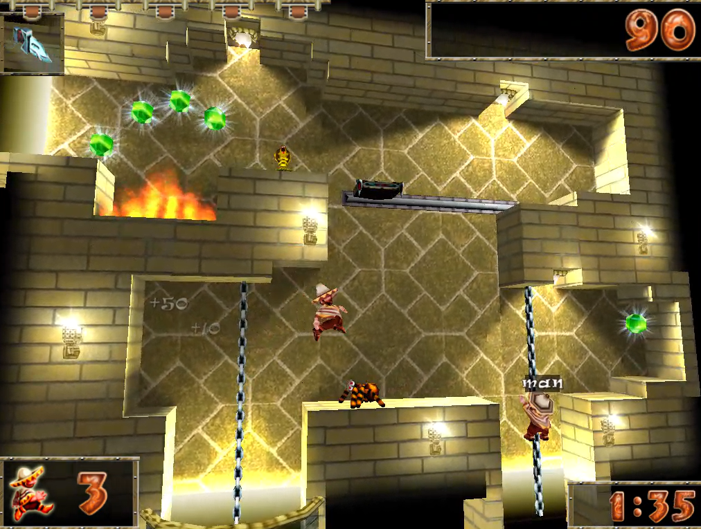

<p align="center">
  
</p>

An online multiplayer mod for **Azangara** built on the [AzForge](https://bazkamaz.github.io/AzForge) modding engine.
Several players explore the same palace together: they see each other, open the same doors,
and the world in every room is identical for all of them.



## Features

A **MULTIPLAYER** item appears in the main menu:

| Action | Description |
|---|---|
| **Create** | Opens a room in the selected palace and starts the level right away |
| **Join** | Joins the selected room |
| **Enter IP** | Connect to an address like `1.2.3.4` or `1.2.3.4:27016` |
| **Palace selection** | Switch with the arrow keys; the button shows the palace's picture |

### Room list

- On this computer and over the local network — via **broadcast**, no setup required.
- Over the Internet — via a shared room list hosted on **Cloudflare Workers**.
- Rooms that answer a ping are shown normally.
- `?` means the host is not reachable from the outside.

## Limitations

- **The host needs an open port.** Clients don't have to configure anything. The host's room is reachable from the Internet only if the host has:
  - a public (white) IP;
  - **UDP 27015–27018** forwarded on the router;

  There is no NAT hole-punching. A host behind CGNAT (common with mobile internet and some ISPs) or behind a VPN cannot be reached from the Internet. Workarounds: a shared virtual network (Radmin VPN, ZeroTier), or let the player with an open port host.
- **Up to 9 players per room** (host + 8 guests).
- **Not everything is synchronized.** Score, level time, and bonuses are per-player. Simultaneous actions by two players on the same object in someone else's room are resolved by the room's owner, so with high latency minor rollbacks are possible.

## Installation

1. Install [AzForge](https://bazkamaz.github.io/AzForge).
2. Put the mod into the mods folder.
3. Start the game: a *MULTIPLAYER* item appears in the main menu.

## Settings

Config keys; the same values can be changed at runtime with the `mp` console command:

| Key | Default | What it does |
|---|---|---|
| `mp_name` | `player` | nickname |
| `mp_port` | `27015` | first port; a second copy of the game takes the first free one within `mp_slots` |
| `mp_slots` | `4` | how many consecutive ports to try |
| `mp_master` | *empty* | a different room-list server; empty means the built-in one |
| `mp_delay` | `0.1` | how far behind other players are rendered, in seconds (smoothing) |
| `mp_lag` / `mp_loss` | `0` | artificial latency (ms) and packet loss (%) for testing |
| `mp_background` | `1` | don't pause the game when it loses focus |

Running `mp` without arguments in the console shows the current status: port, role, ping, loss, and players.

## Building

- Visual Studio 2026, solution `AzangaraMultiplayer.slnx` (Win32).
- Requires the AzForge SDK (headers in `sdk/include`).
- System libraries used: `ws2_32`, `user32`, `winhttp`.

## Running your own server

### 1. Creating an account

Sign up at **[dash.cloudflare.com](https://dash.cloudflare.com)**.

---

### 2. Creating a D1 database

Open:

**Storage & Databases → D1 → Create**

Enter a database name (example):

```text
azangara-online
```

Once created, open the **Console** tab, paste the contents of the `schema.sql` file, and press **Execute**.

---

### 3. Creating a Worker

Go to:

**Workers & Pages → Create → Worker**

Choose the **Hello World** template and press **Deploy**.

Once created, open:

**Edit code**

Replace all the existing code with the contents of `worker.js` and press **Deploy** again.

---

### 4. Connecting the database

In the Worker's settings, open:

**Settings → Bindings → Add → D1 database**

Set the following parameters:

| Parameter | Value |
|---|---|
| Variable name | `DB` |
| D1 database | `<your-db-name>` |

---

### 5. Testing the Worker

Take note of the created Worker's address. It will look something like this:

```text
https://<your-db-name>.<your-account>.workers.dev
```

Check that it works by opening the following in a browser:

```text
https://<your-db-name>.<your-account>.workers.dev/rooms?version=18
```

An **empty page without an error** should open.

### 6. Hooking it into the code

There are two ways

| Way | What to do |
|---|---|
| mp_master | `In Azangara.cfg, add (if not already present) 'mp_master = <url>'` |
| MASTER_URL | `In Mod.cpp, change the URL in the MASTER_URL variable to your own` |
